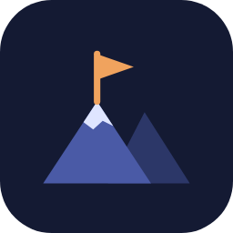
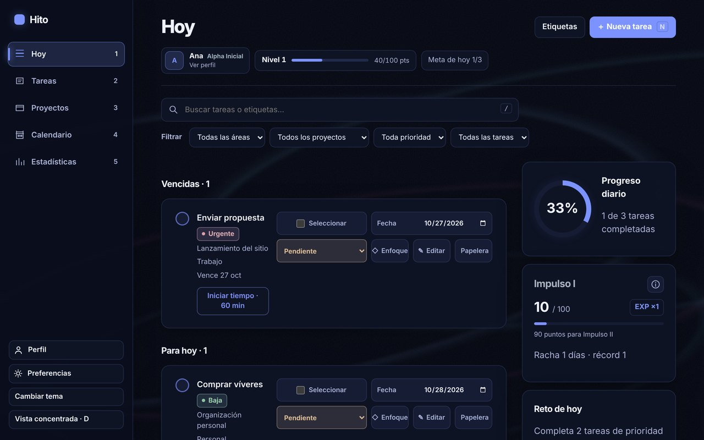
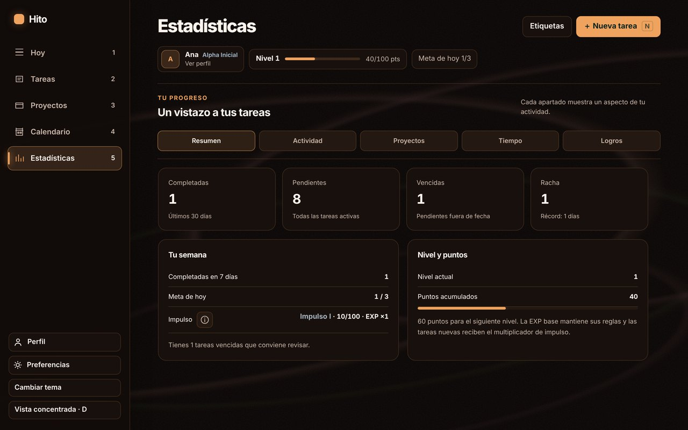
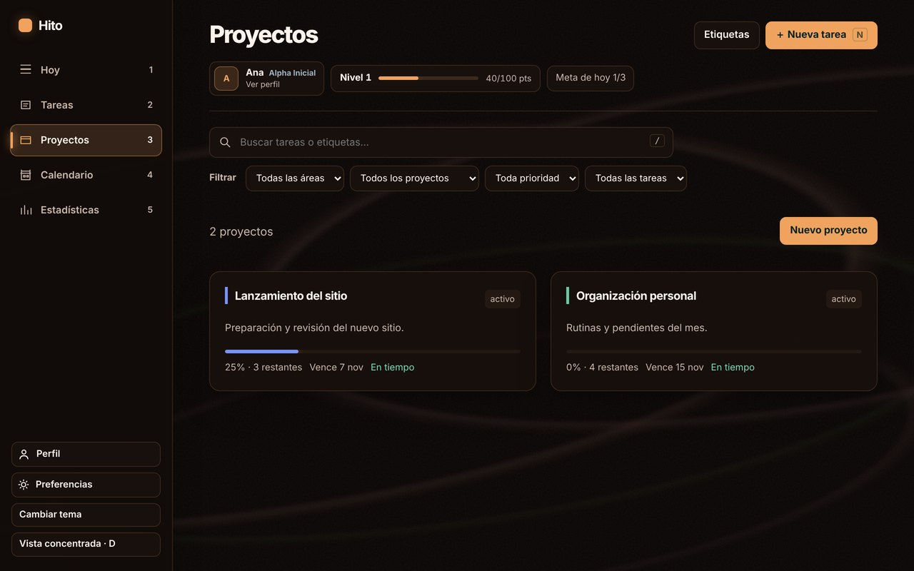
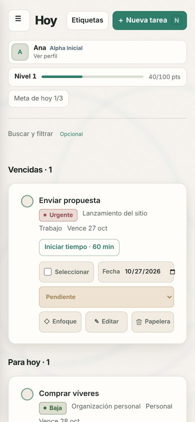
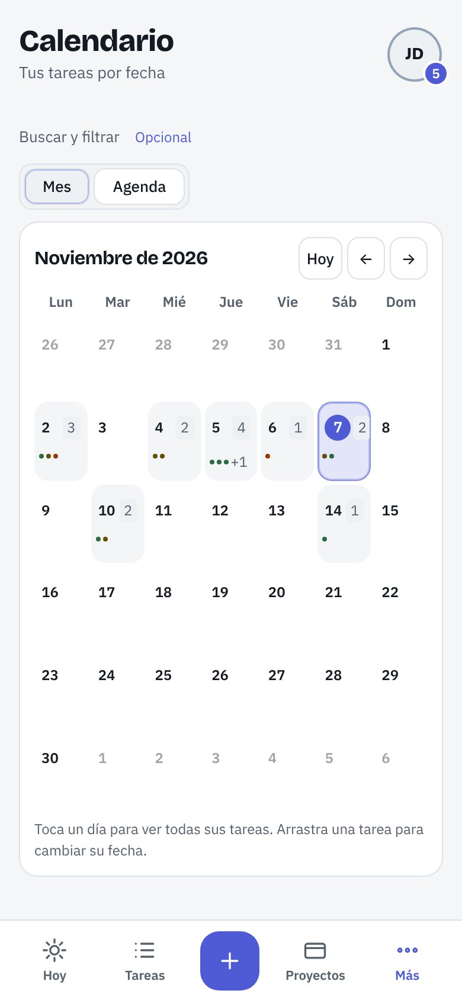

  

<h1 align="center">Hito</h1>

<strong>Tus tareas y proyectos, con constancia.</strong> 
Organiza tu día, sube de nivel y no pierdas el ritmo. Para Android y Windows.

  <a href="https://github.com/jeanskull/Hito-release/releases/download/v0.7.1-ensayo/Hito_0.7.1_android.apk"><strong>Descargar para Android</strong></a>
  &nbsp;·&nbsp;
  <a href="https://github.com/jeanskull/Hito-release/releases/download/v0.7.1-ensayo/Hito_0.7.1_x64-setup.exe"><strong>Descargar para Windows</strong></a>
  &nbsp;·&nbsp;
  <a href="https://github.com/jeanskull/Hito-release/releases">Todas las versiones</a>

Versión de prueba 0.7.1 · Android 7 o superior · Windows 10 y 11 (64 bits)

  

## Qué puedes hacer

- **Tareas y proyectos** con prioridad, fecha, pasos, etiquetas de color, repetición y tiempo estimado.
- **Hoy, calendario y tablero** para ver qué toca, qué está vencido y en qué concentrarte.
- **Progreso que se nota:** cada tarea suma puntos de experiencia, subes de nivel, desbloqueas logros y acumulas *impulso* para multiplicar tus puntos.
- **Estadísticas** de tu semana, tus proyectos y tu tiempo.
- **Temporizador de enfoque** y recordatorios de lo que vence.
- **A tu gusto:** temas Medianoche, Brasa y Papel, fondos y música ambiental original.
- **Funciona sin conexión.** Tus datos se guardan en tu dispositivo y Hito hace un respaldo automático cada semana.

  
  

  
  &nbsp;&nbsp;
  

## Instalar en Android

1. Abre en tu celular el enlace **Descargar para Android** y descarga el archivo `.apk`.
2. Ábrelo desde las notificaciones o desde la carpeta Descargas.
3. Si Android pide permiso para *instalar apps de fuentes desconocidas*, actívalo para tu navegador o para «Archivos» y vuelve atrás.
4. Si aparece Google Play Protect, elige **Más detalles → Instalar de todas formas**. Aparece porque Hito todavía no se distribuye por Play Store.
5. Toca **Instalar** y abre Hito.

## Instalar en Windows

1. Descarga el instalador con el enlace **Descargar para Windows**.
2. Ábrelo. Si Windows muestra *«Windows protegió tu PC»*, elige **Más información → Ejecutar de todas formas**. El aviso sale porque el instalador aún no tiene un certificado comercial de editor.
3. Sigue los pasos del instalador y abre Hito desde el menú Inicio.

## Actualizaciones

No tienes que volver a descargar nada: Hito te avisa dentro de la app cuando hay una versión nueva, en **Preferencias → Acerca de y actualizaciones**. La descarga se verifica antes de instalarse y tus datos se conservan.

## Tus datos

- Tus tareas y proyectos se guardan **solo en tu dispositivo**. No necesitas cuenta.
- Cada semana Hito guarda una copia de seguridad automática: en Windows en *Documentos\Hito\Respaldos*, y en Android 10 o superior en *Descargas/Hito*. También puedes exportar un respaldo cuando quieras desde Preferencias.
- La sincronización entre celular y computadora llegará en una próxima versión.

## Cuéntanos qué tal

¿Algo falló o tienes una idea? En **Preferencias → Acerca de y actualizaciones → Enviar comentarios** puedes escribirnos directo desde la app. Solo se envía tu mensaje y, si lo permites, la versión, la plataforma y el tamaño de pantalla; **nunca tus tareas ni proyectos**.

## Novedades de la 0.7.1

**Agregado**

- Cierre del día: muestra lo que quedó pendiente y puedes pasarlo a mañana tarea por tarea o todo junto.
- Filtro rápido por etiqueta en Tareas: tus etiquetas más usadas aparecen arriba con su color; tócalas para ver solo esas tareas.
- Cada proyecto muestra su siguiente tarea (la que vence antes).

**Mejorado**

- Hoy: las vencidas van aparte y solo se ven 3; «Ver las N» muestra todas y «Pasar todas a hoy» las reprograma de un toque.
- En el celular la casilla para completar una tarea es más grande y fácil de tocar, igual que los días del calendario.

## Novedades de la 0.7.0

**Mejorado**

- Nuevo diseño de la familia JeanSkull Apps: mismas letras y colores que Cuentas Claras, para que pasar de una app a otra se sienta natural.
- En el celular hay una barra abajo con Hoy, Tareas, Nueva tarea, Proyectos y Más, como en Cuentas Claras. «Más» abre Calendario, Estadísticas, Perfil, Preferencias y Tema.
- Celular en horizontal: la barra pasa a ser una barra delgada a la izquierda, los filtros empiezan cerrados y las tareas se ven sin desplazarte.
- Si se juntan muchos avisos (por ejemplo al importar un respaldo), solo se muestran los 2 más recientes en vez de una fila larga.

**Corregido**

- En pantallas bajas (celular en horizontal o ventanas chicas) los botones de Perfil y Preferencias tapaban «Estadísticas» en el menú.
- En celulares angostos la barra de nivel se encimaba con la meta del día; ahora la meta baja de línea.
- Los avisos que aparecen abajo ya no tapan ni bloquean la barra de navegación.

Desde la app puedes ver el historial completo en **Preferencias → Acerca de y actualizaciones → Novedades**.

## Estado del proyecto

Hito está en **versión de prueba**: funciona y se usa a diario, pero puede tener detalles por pulir. Por eso tus comentarios ayudan mucho.

---

Creado por <strong>JeanSkull</strong> · Desarrollado con la ayuda de Codex y Claude

