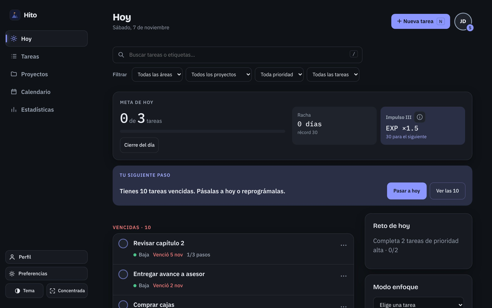
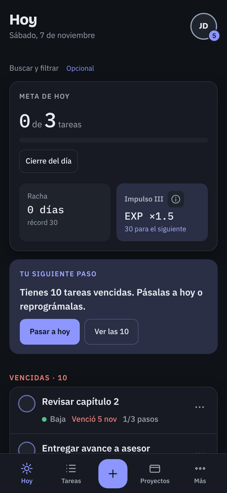

  

<h1 align="center">Hito</h1>

<strong>Tus tareas y proyectos, con constancia.</strong> 
Organiza tu día, sube de nivel y no pierdas el ritmo. Para Android y Windows.

  <a href="https://github.com/jeanskull/Hito-release/releases/download/v1.1.1-ensayo/Hito_1.1.1_android.apk"><strong>Descargar para Android</strong></a>
  &nbsp;·&nbsp;
  <a href="https://github.com/jeanskull/Hito-release/releases/download/v1.1.1-ensayo/Hito_1.1.1_x64-setup.exe"><strong>Descargar para Windows</strong></a>
  &nbsp;·&nbsp;
  <a href="https://github.com/jeanskull/Hito-release/releases">Todas las versiones</a>

Versión de prueba 1.1.1 · Android 7 o superior · Windows 10 y 11 (64 bits)

  

## Qué puedes hacer

- **Tareas y proyectos** con prioridad, fecha, pasos, etiquetas de color, repetición y tiempo estimado.
- **Hoy, calendario y tablero** para ver qué toca, qué está vencido y en qué concentrarte.
- **Progreso que se nota:** cada tarea suma puntos de experiencia, subes de nivel, desbloqueas logros y acumulas *impulso* para multiplicar tus puntos. Cada rango nuevo se revela con una celebración, y el siguiente siempre es un misterio.
- **Estadísticas** de tu semana, tus proyectos y tu tiempo.
- **Temporizador de enfoque** y recordatorios de lo que vence.
- **A tu gusto:** tema oscuro, claro o según el sistema, vista concentrada para ver más tareas con menos adornos y música ambiental original.
- **Funciona sin conexión.** Tus datos se guardan en tu dispositivo y Hito hace un respaldo automático cada semana.

  
  

  
  &nbsp;&nbsp;
  

## Instalar en Android

1. Abre en tu celular el enlace **Descargar para Android** y descarga el archivo `.apk`.
2. Ábrelo desde las notificaciones o desde la carpeta Descargas.
3. Si Android pide permiso para *instalar apps de fuentes desconocidas*, actívalo para tu navegador o para «Archivos» y vuelve atrás.
4. Si aparece Google Play Protect, elige **Más detalles → Instalar de todas formas**. Aparece porque Hito todavía no se distribuye por Play Store.
5. Toca **Instalar** y abre Hito.

## Instalar en Windows

1. Descarga el instalador con el enlace **Descargar para Windows**.
2. Ábrelo. Si Windows muestra *«Windows protegió tu PC»*, elige **Más información → Ejecutar de todas formas**. El aviso sale porque el instalador aún no tiene un certificado comercial de editor.
3. Sigue los pasos del instalador y abre Hito desde el menú Inicio.

## Actualizaciones

No tienes que volver a descargar nada: Hito te avisa dentro de la app cuando hay una versión nueva, en **Preferencias → Acerca de y actualizaciones**. La descarga se verifica antes de instalarse y tus datos se conservan.

## Tus datos

- Tus tareas y proyectos se guardan **solo en tu dispositivo**. No necesitas cuenta.
- Cada semana Hito guarda una copia de seguridad automática: en Windows en *Documentos\Hito\Respaldos*, y en Android 10 o superior en *Descargas/Hito*. También puedes exportar un respaldo cuando quieras desde Preferencias.
- La sincronización entre celular y computadora llegará en una próxima versión.

## Cuéntanos qué tal

¿Algo falló o tienes una idea? En **Preferencias → Acerca de y actualizaciones → Enviar comentarios** puedes escribirnos directo desde la app. Solo se envía tu mensaje y, si lo permites, la versión, la plataforma y el tamaño de pantalla; **nunca tus tareas ni proyectos**.

## Novedades de la 1.1.1

**Corregido**

- Celular, hoja «Más»: el tema ahora se elige ahí mismo entre Oscuro, Claro y Sistema, y la hoja se queda abierta para que veas el cambio. Antes cada toque pasaba al siguiente tema y cerraba la hoja, así que a veces había que abrirla dos veces.
- Celular: el aviso «Hito está lista · Instalar» ya no sale como un cuadro enorme; ahora es una tarjeta compacta con sus botones.
- Animación de rango nuevo (celular y PC): el nombre ya no se parte entre letras ni se sale de la pantalla (si no cabe, la letra se achica), y la insignia queda centrada en su lugar en vez de bajarse y encimarse con el texto.

## Novedades de la 1.1.0

**Mejorado**

- Estadísticas → Actividad: los últimos 30 días ahora se ven como una curva suave con área, en lugar de barras. Al pasar el cursor sobre un día ves cuántas tareas completaste. La curva nunca dibuja subidas ni bajadas que no pasaron.

**Corregido**

- Un rango nuevo ya no se adelanta: si subes de rango (por ejemplo, de Alpha a Beta), el avatar, el número de nivel, la barra y tu perfil se quedan en el último nivel de tu rango anterior, con la barra llena, hasta que ves la celebración. Funciona igual en Hito, Cuentas Claras y Reliquia.

Desde la app puedes ver el historial completo en **Preferencias → Acerca de y actualizaciones → Novedades**.

## Estado del proyecto

Hito está en **versión de prueba**: funciona y se usa a diario, pero puede tener detalles por pulir. Por eso tus comentarios ayudan mucho.

---

Creado por <strong>JeanSkull</strong> · Desarrollado con la ayuda de Codex y Claude

