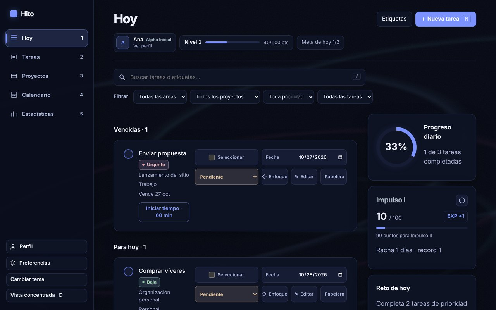
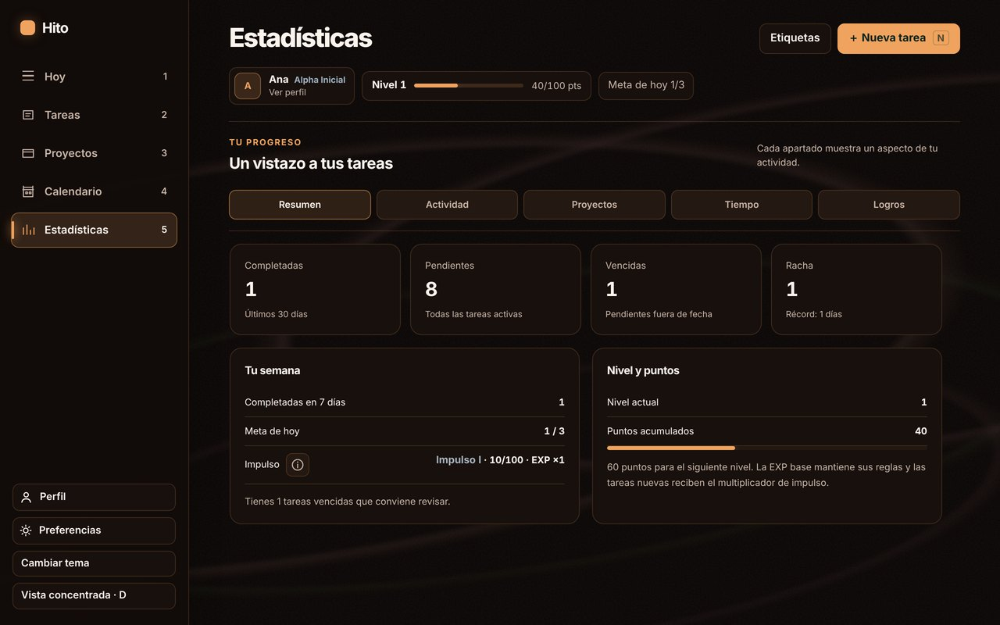
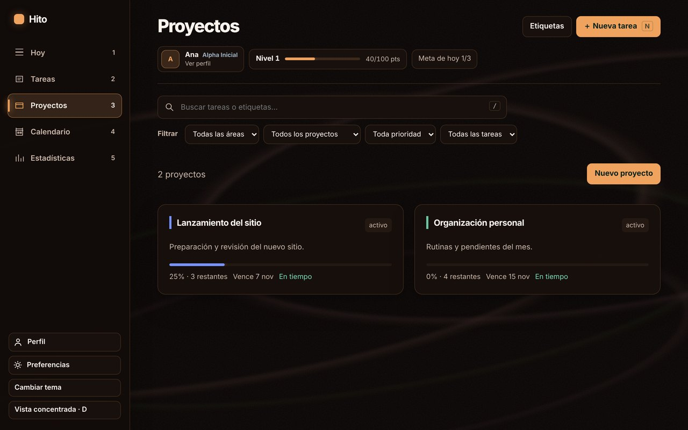
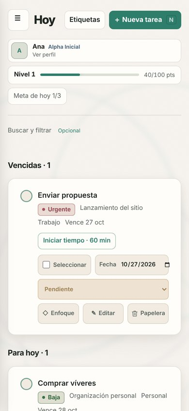
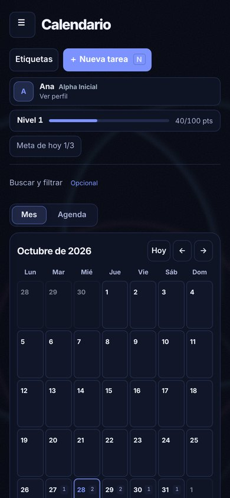

  

<h1 align="center">Hito</h1>

<strong>Tus tareas y proyectos, con constancia.</strong> 
Organiza tu día, sube de nivel y no pierdas el ritmo. Para Android y Windows.

  <a href="https://github.com/jeanskull/Hito-release/releases/download/v0.5.1-ensayo/panel-debug-0.5.1.apk"><strong>Descargar para Android</strong></a>
  &nbsp;·&nbsp;
  <a href="https://github.com/jeanskull/Hito-release/releases/download/v0.5.1-ensayo/Hito_0.5.1_x64-setup.exe"><strong>Descargar para Windows</strong></a>
  &nbsp;·&nbsp;
  <a href="https://github.com/jeanskull/Hito-release/releases">Todas las versiones</a>

Versión de prueba 0.5.1 · Android 7 o superior · Windows 10 y 11 (64 bits)

  

## Qué puedes hacer

- **Tareas y proyectos** con prioridad, fecha, pasos, etiquetas de color, repetición y tiempo estimado.
- **Hoy, calendario y tablero** para ver qué toca, qué está vencido y en qué concentrarte.
- **Progreso que se nota:** cada tarea suma puntos de experiencia, subes de nivel, desbloqueas logros y acumulas *impulso* para multiplicar tus puntos.
- **Estadísticas** de tu semana, tus proyectos y tu tiempo.
- **Temporizador de enfoque** y recordatorios de lo que vence.
- **A tu gusto:** temas Medianoche, Brasa y Papel, fondos y música ambiental original.
- **Funciona sin conexión.** Tus datos se guardan en tu dispositivo y Hito hace un respaldo automático cada semana.

  
  

  
  &nbsp;&nbsp;
  

## Instalar en Android

1. Abre en tu celular el enlace **Descargar para Android** y descarga el archivo `.apk`.
2. Ábrelo desde las notificaciones o desde la carpeta Descargas.
3. Si Android pide permiso para *instalar apps de fuentes desconocidas*, actívalo para tu navegador o para «Archivos» y vuelve atrás.
4. Si aparece Google Play Protect, elige **Más detalles → Instalar de todas formas**. Aparece porque Hito todavía no se distribuye por Play Store.
5. Toca **Instalar** y abre Hito.

## Instalar en Windows

1. Descarga el instalador con el enlace **Descargar para Windows**.
2. Ábrelo. Si Windows muestra *«Windows protegió tu PC»*, elige **Más información → Ejecutar de todas formas**. El aviso sale porque el instalador aún no tiene un certificado comercial de editor.
3. Sigue los pasos del instalador y abre Hito desde el menú Inicio.

## Actualizaciones

No tienes que volver a descargar nada: Hito te avisa dentro de la app cuando hay una versión nueva, en **Preferencias → Acerca de y actualizaciones**. La descarga se verifica antes de instalarse y tus datos se conservan.

## Tus datos

- Tus tareas y proyectos se guardan **solo en tu dispositivo**. No necesitas cuenta.
- Cada semana Hito guarda una copia de seguridad automática: en Windows en *Documentos\Hito\Respaldos*, y en Android 10 o superior en *Descargas/Hito*. También puedes exportar un respaldo cuando quieras desde Preferencias.
- La sincronización entre celular y computadora llegará en una próxima versión.

## Cuéntanos qué tal

¿Algo falló o tienes una idea? En **Preferencias → Acerca de y actualizaciones → Enviar comentarios** puedes escribirnos directo desde la app. Solo se envía tu mensaje y, si lo permites, la versión, la plataforma y el tamaño de pantalla; **nunca tus tareas ni proyectos**.

## Novedades de la 0.5.1

**Mejorado**

- Las actualizaciones se descargan desde el nuevo repositorio público «Hito-release». La app sigue aceptando la dirección anterior, con las mismas comprobaciones de seguridad.
- Créditos con el nombre del creador, JeanSkull. En Windows, «Aplicaciones instaladas» muestra a JeanSkull como editor.

## Novedades de la 0.5.0

**Agregado**

- Nuevo nombre: **Hito** (antes Panel de seguimiento), con ícono nuevo de una bandera sobre una cima en Windows, Android (incluido el ícono temático de Android 13+ y el de las notificaciones) y la versión web.
- Tres temas completos: Medianoche (nuevo predeterminado), Brasa y Papel, con su propio fondo, tarjetas, texto y color de acento. Se eligen en Preferencias → Vista y ritmo o con «Cambiar tema».
- Opción de fondo: Ondas, Liso o Puntos.
- Enviar comentarios desde Preferencias → Acerca de y actualizaciones: elige si algo falló, una idea u otra cosa y escribe tu mensaje. Puedes incluir datos técnicos (versión, plataforma y pantalla); nunca se envían tus tareas ni proyectos. Sin conexión, el comentario se guarda y se envía solo al volver la red.

**Mejorado**

- Si nunca cambiaste el color de acento, cada tema usa el suyo; un acento personalizado se conserva.
- La barra del sistema en Android toma el color del tema.
- El tema verde anterior se retira: si lo usabas, ahora verás Medianoche. Puedes cambiarlo en Preferencias.
- Tus datos sincronizados en la nube quedan mejor protegidos: nadie puede listar ni borrar los grupos de sincronización; solo se accede a cada uno con su clave, como siempre.
- En Windows, al actualizar, Hito reemplaza la instalación «Panel de seguimiento» y conserva tus datos: no quedan dos apps instaladas.
- Los respaldos automáticos nuevos se guardan en la carpeta «Hito» (Documentos\Hito\Respaldos en Windows, Descargas/Hito en Android). Los anteriores se quedan donde estaban.

**Corregido**

- La pantalla de carga de Android mostraba el logo genérico de la herramienta de desarrollo sobre fondo blanco; ahora muestra el ícono de Hito sobre el fondo del tema.

Desde la app puedes ver el historial completo en **Preferencias → Acerca de y actualizaciones → Novedades**.

## Estado del proyecto

Hito está en **versión de prueba**: funciona y se usa a diario, pero puede tener detalles por pulir. Por eso tus comentarios ayudan mucho.

---

Creado por <strong>JeanSkull</strong> · Desarrollado con la ayuda de Codex y Claude

