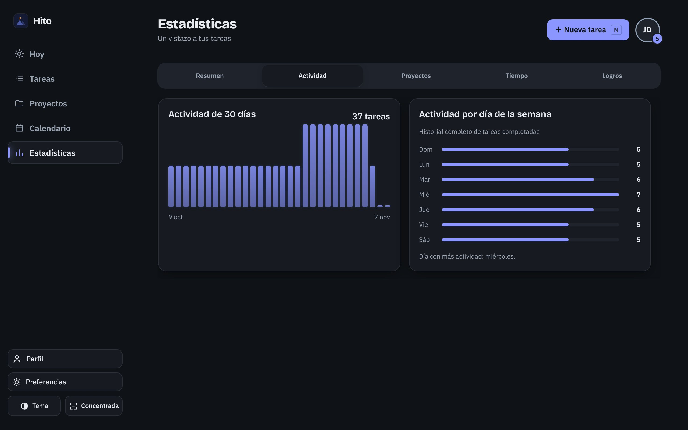
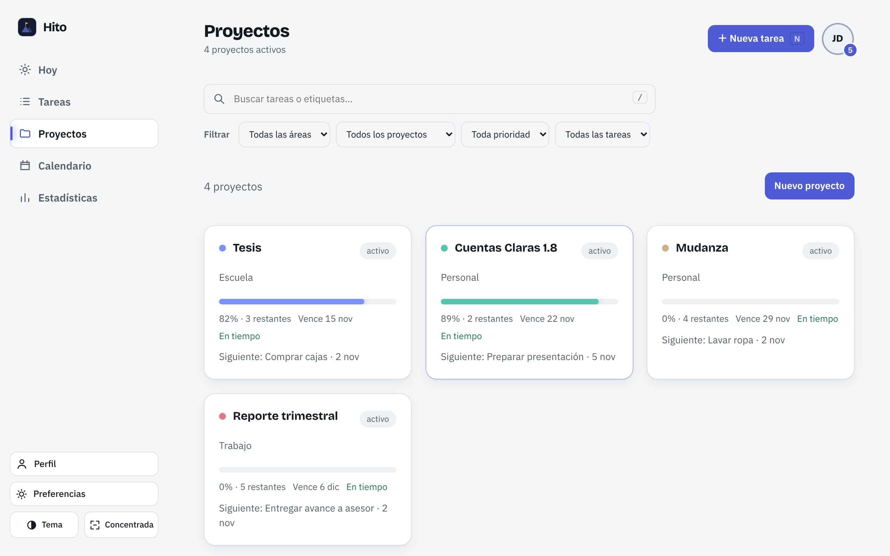
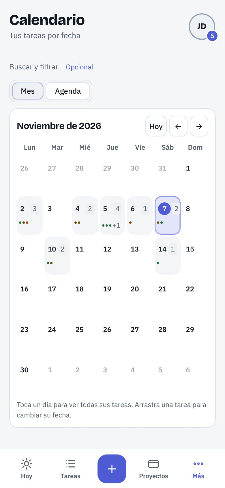

  

<h1 align="center">Hito</h1>

<strong>Tus tareas y proyectos, con constancia.</strong> 
Organiza tu día, sube de nivel y no pierdas el ritmo. Para Android y Windows.

  <a href="https://github.com/jeanskull/Hito-release/releases/download/v1.2.1-ensayo/Hito_1.2.1_android.apk"><strong>Descargar para Android</strong></a>
  &nbsp;·&nbsp;
  <a href="https://github.com/jeanskull/Hito-release/releases/download/v1.2.1-ensayo/Hito_1.2.1_x64-setup.exe"><strong>Descargar para Windows</strong></a>
  &nbsp;·&nbsp;
  <a href="https://github.com/jeanskull/Hito-release/releases">Todas las versiones</a>

Versión de prueba 1.2.1 · Android 7 o superior · Windows 10 y 11 (64 bits)

  

## Qué puedes hacer

- **Tareas y proyectos** con prioridad, fecha, pasos, etiquetas de color, repetición y tiempo estimado.
- **Hoy, calendario y tablero** para ver qué toca, qué está vencido y en qué concentrarte.
- **Progreso que se nota:** cada tarea suma puntos de experiencia, subes de nivel, desbloqueas logros y acumulas *impulso* para multiplicar tus puntos. Cada rango nuevo se revela con una celebración, y el siguiente siempre es un misterio.
- **Estadísticas** de tu semana, tus proyectos y tu tiempo.
- **Temporizador de enfoque** y recordatorios de lo que vence.
- **A tu gusto:** tema oscuro, claro o según el sistema, vista concentrada para ver más tareas con menos adornos y música ambiental original.
- **Funciona sin conexión.** Tus datos se guardan en tu dispositivo y Hito hace un respaldo automático cada semana.

  
  

  
  &nbsp;&nbsp;
  

## Instalar en Android

1. Abre en tu celular el enlace **Descargar para Android** y descarga el archivo `.apk`.
2. Ábrelo desde las notificaciones o desde la carpeta Descargas.
3. Si Android pide permiso para *instalar apps de fuentes desconocidas*, actívalo para tu navegador o para «Archivos» y vuelve atrás.
4. Si aparece Google Play Protect, elige **Más detalles → Instalar de todas formas**. Aparece porque Hito todavía no se distribuye por Play Store.
5. Toca **Instalar** y abre Hito.

## Instalar en Windows

1. Descarga el instalador con el enlace **Descargar para Windows**.
2. Ábrelo. Si Windows muestra *«Windows protegió tu PC»*, elige **Más información → Ejecutar de todas formas**. El aviso sale porque el instalador aún no tiene un certificado comercial de editor.
3. Sigue los pasos del instalador y abre Hito desde el menú Inicio.

## Actualizaciones

No tienes que volver a descargar nada: Hito te avisa dentro de la app cuando hay una versión nueva, en **Preferencias → Acerca de y actualizaciones**. La descarga se verifica antes de instalarse y tus datos se conservan.

## Tus datos

- Tus tareas y proyectos se guardan **solo en tu dispositivo**. No necesitas cuenta.
- Cada semana Hito guarda una copia de seguridad automática: en Windows en *Documentos\Hito\Respaldos*, y en Android 10 o superior en *Descargas/Hito*. También puedes exportar un respaldo cuando quieras desde Preferencias.
- La sincronización entre celular y computadora llegará en una próxima versión.

## Cuéntanos qué tal

¿Algo falló o tienes una idea? En **Preferencias → Acerca de y actualizaciones → Enviar comentarios** puedes escribirnos directo desde la app. Solo se envía tu mensaje y, si lo permites, la versión, la plataforma y el tamaño de pantalla; **nunca tus tareas ni proyectos**.

## Novedades de la 1.2.1

**Corregido**

- Sonido: los interruptores «Sonidos» y «Música ambiental» de la hoja «Más» salían apagados al abrir la app aunque la música y los sonidos se seguían oyendo. Ahora muestran lo que de verdad está activo desde el arranque: encendido suena, apagado queda en silencio.
- Hoja «Más»: la música ya no sale encendida si los sonidos están apagados (en ese caso no suena), y al encenderla ahí también se encienden los sonidos.

## Novedades de la 1.2.0

**Mejorado**

- Preferencias se ven igual que en Cuentas Claras y Reliquia: en el celular ocupan toda la pantalla, con botón para volver, grupos con título (Tu cuenta, La app, Tus datos y Hito) y una fila con icono para cada apartado. Ya no es una ventana flotante con un botón «Cerrar» abajo.
- Cada apartado de Preferencias se acomoda en tarjetas con su título, los controles a la derecha y la ayuda en gris. Los interruptores son los mismos de las demás apps, y el tema se elige con tres botones: Oscuro, Claro y Sistema.
- Novedades tiene su propia fila en Preferencias (antes estaba escondida en «Acerca de»), con la etiqueta «Nuevo» mientras no la abras. El historial va por mes y año: el mes actual abierto y los anteriores plegados con cuántas versiones traen. Si un mes trae muchas versiones, se separa por semanas, y cada versión muestra un resumen («2 nuevos · 1 mejora») que se abre al tocarla.
- Al actualizar, «Lo nuevo» sale como hoja desde abajo, igual que en Reliquia y Cuentas Claras, con la estrella, tu versión y el botón «Entendido».

**Corregido**

- Preferencias → Acerca de: el título decía «Acerca de y actualizaciones» y el texto quedaba pegado al borde de su recuadro.

Desde la app puedes ver el historial completo en **Preferencias → Acerca de y actualizaciones → Novedades**.

## Estado del proyecto

Hito está en **versión de prueba**: funciona y se usa a diario, pero puede tener detalles por pulir. Por eso tus comentarios ayudan mucho.

---

Creado por <strong>JeanSkull</strong> · Desarrollado con la ayuda de Codex y Claude

